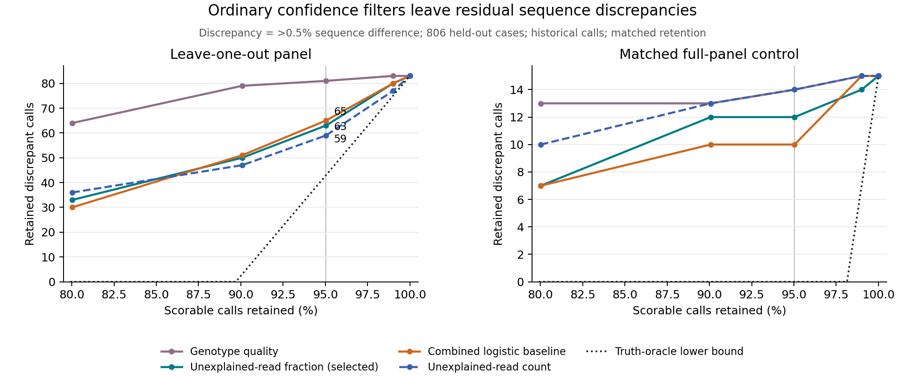

# Panel-adequacy baseline: results and decision

9 October 2026. **Completed historical reanalysis; no new caller or alignment
algorithm was developed.**

**Decision: proceed only to a small read-level case audit.** Ordinary filters
leave appreciable sequence discrepancies on unseen donors and loci, but this
study does not establish that a new panel-adequacy algorithm can detect them.
A simple combined confidence model did not improve on the scalar baseline
chosen using calibration data. Current software, meaningful indel classes and
read-level observability must be tested before algorithm development.

## Primary finding

Of **806 scorable held-out leave-one-out calls**, 83 exceeded the predeclared
0.5% diploid sequence-discrepancy threshold. At matched 95% retention
(766/806 = 95.04%), the calibration-selected unexplained-read-fraction filter
left **63 discrepancies**, compared with **65** for fixed logistic regression
combining native diagnostics. Genotype quality alone left **81**.

The unexplained-read-count filter left 59 on test. It had narrowly lost to the
fraction filter on calibration (92 versus 91 retained discrepancies), so we
report its result without retrospectively replacing the selected baseline.
This distinction matters: the best observed test result is not an independently
selected deployment rule.

| Filter | Retained calls | Retained discrepancies | Discrepancies among retained calls |
| --- | ---: | ---: | ---: |
| No filtering | 806 | 83 | 10.30% |
| Genotype quality | 766 | 81 | 10.57% |
| Weighted distance | 766 | 74 | 9.66% |
| **Unexplained-read fraction — selected on calibration** | **766** | **63** | **8.22%** |
| Unexplained-read count | 766 | 59 | 7.70% |
| Recruited-read count | 766 | 71 | 9.27% |
| Combined logistic baseline | 766 | 65 | 8.49% |
| Outcome-independent hash control | 766 | 78 | 10.18% |

All discrepancies in this report are **sequence-comparison proxies**, not
validated wrong structural genotypes. No truth-derived QV, comparison length,
closest-available metric or haplotype identity entered a predictor.



The dotted curve is a post-hoc perfect-label rejection-budget bound, not a
deployable algorithm. Curves compare retrospective batch rankings. Their
thresholds are not asserted to achieve the same retention in a future cohort.
The full-panel controls have their own rankings under the unchanged LOO-fitted
model. Different vertical scales make their lower discrepancy counts visible.

## What was frozen and evaluated

The [protocol](PANEL_BASELINE_PROTOCOL.md), exact source snapshots, donor/locus
assignments and analysis code were published in commit
[`d6d3b76`](https://github.com/comparativechrono/certified-alignment/commit/d6d3b76ff823c85dafed3704667ad1713df17750)
before the first new outcome analysis. Published paper-level findings were
already known, so this was a pre-specified retrospective reanalysis rather than
an independent preregistration. The run completed once, with no post-freeze
change to the model, splits, labels or analysis code.

The [pinned Locityper archive](https://doi.org/10.5281/zenodo.15879519) supplies
40 donors × 326 loci under both full and leave-one-out panels. Only genotype
rows were used. Overlapping loci were grouped into 317 interval components;
development, calibration and test separate both donor IDs and these groups.

| Partition | Published genotype cases | Scorable cases | Excluded truth comparisons |
| --- | ---: | ---: | ---: |
| Development | 3,220 | 3,134 | 86 |
| Calibration | 840 | 837 | 3 |
| Test | 810 | 806 | 4 |
| Off-diagonal, descriptive only | 8,170 | 8,092 | 78 |
| Total | 13,040 | 12,869 | 171 |

Both panel conditions have the same scorable keys. The test comprises ten
donors and 81 loci in 80 overlap groups. The excluded comparisons failed the
predeclared finite-divergence/positive-comparison-size criteria; they were not
counted as correct. These are published evaluable calls, not all attempted
calls. Original caller and reference-panel construction did not use our later
filter splits; relatives and non-overlapping homologues are not guaranteed
independent.

The archive README says v0.17.3, while embedded table commands name v0.17.0
summaries. We preserve that unresolved provenance and do not claim to have
rerun either version. [Source hashes and licences](../data/panel_adequacy/SOURCE_MANIFEST.json)
identify the exact archived bytes. The currently verified Locityper executable
is a much later version; this study does not measure its accuracy.

## Threshold transfer and uncertainty

The fraction cutoff chosen to retain 95% on calibration was approximately
**2.129% unexplained reads**, with a frozen hash rule for ties. Transferred
unchanged, it retained **771/806 calls (95.66%)**, including 64 discrepancies
(8.30% of accepted calls). The logistic cutoff retained 767/806 (95.16%), with
65 discrepancies (8.47%). These actual-retention results are separate from
the matched-retention comparison above.

At matched retention, the selected scalar's discrepancy fraction was 8.22%
with a conditional two-way bootstrap 95% interval of **4.12–13.09%**. The
logistic-minus-scalar difference in retained discrepancies per eligible case
was +0.25 percentage points, with interval **−0.75 to +1.69 percentage points**.
There is no demonstrated advantage for the combined model. These are 4,999
paired donor × overlap-group bootstrap replicates with fixed fitted models
and decisions. Ten donor clusters, hidden relatedness and no retraining in the
bootstrap limit generalization; these are not clinical confidence guarantees.

Changing only the evaluation threshold gave the same qualitative comparison:

| Sequence-discrepancy threshold | Unfiltered discrepancies | Fraction filter retained | Logistic retained |
| --- | ---: | ---: | ---: |
| >0.1% | 228 | 189 | 190 |
| **>0.5% — primary** | **83** | **63** | **65** |
| >1.0% | 47 | 34 | 35 |

Models, filter choice and acceptance decisions were not refitted for these
sensitivity outcomes.

## Panel controls and the size of the remaining opportunity

The matched full-panel test calls had **15/806** discrepancies before filtering,
compared with 83/806 under leave-one-out. At matched 95% retention, the LOO-trained
fraction filter retained 12 full-panel discrepancies and logistic retained ten.
The fraction cutoff transferred from LOO actually accepted all 806 full-panel
calls; claiming its matched-retention result as fixed-threshold performance
would therefore be incorrect.

The following breakdowns were added **after** the frozen run for interpretation,
not used to select a filter or claim independent validation. The selected
fraction filter's 63 residual LOO discrepancies span **all ten test donors and
29 loci**. MUC1 contributes ten and TPO six; six loci collectively contribute
32/63. The result is not confined to one locus, but substantial clustering
remains.

| Within the 63 residual cases | Full-panel comparison ≤0.5% | Full-panel comparison >0.5% |
| --- | ---: | ---: |
| Published closest-available comparison >0.5% | 22 | 4 |
| Published closest-available comparison ≤0.5% | 27 | 10 |

The 22 cases in the first cell are candidates for investigating a panel
representation problem. The 27 in the lower-left cell instead suggest examining
candidate selection and confidence. Neither cell proves a missing structural
allele: the comparator is a sequence metric, not a certified global optimum,
and no breakpoint-support or assembly-truth audit has been performed. The 14
cases discrepant even in the full panel deserve separate truth and calling
checks. Selecting cases for investigation from this table does not create a
new independent test set.

**The rejection budget limits what an abstention-only method can achieve.** At
766 accepted calls, only 40 of 806 may be rejected. With 83 initial discrepancies,
even an oracle knowing every label must retain at least `83 − 40 = 43`, or
5.61% of accepted calls. Relative to the selected filter's 63, at most another
20 can be removed at this retention: a 31.75% relative reduction. Relative to
the retrospectively best count filter's 59, the ceiling is 16 (27.12%). This
arithmetic is a label-aware bound, not evidence that reads reveal the extra
cases. The residual count alone must not be mistaken for unrestricted room
for improvement. Correcting genotypes or expanding a panel is a different task.

## Secondary COSIGT context

The [COSIGT paper tables](https://github.com/davidebolo1993/cosigt_paper) contain
truth-derived similarity measures but no per-case deployable confidence scores.
We therefore performed no COSIGT filter comparison. Full and alternate-panel
COSIGT calls were paired on identical donor–region keys:

| Cohort | Paired cases | Full-panel discrepancies | Alternate-panel discrepancies | Best-available comparator >0.5% |
| --- | ---: | ---: | ---: | ---: |
| CMRG | 11,674 | 326 | 1,674 | 629 |
| Large-SV loci | 14,838 | 585 | 2,326 | 898 |

These use the published average of the two haplotype error fractions, not
Locityper's length-weighted diploid divergence. The protocols, panels and
datasets differ, so the table is not a direct tool comparison or replication
of the primary confidence experiment. It supports the descriptive observation
that changing to an alternate panel increases sequence discrepancy.

Exactly 24 byte-identical duplicate SV rows were removed, as declared before
analysis. The full tables had 650 CMRG and 469 SV keys absent from the all-out
tables; only paired keys enter this table. Companion full-panel Locityper truth
metrics have five and 22 unscorable rows respectively, separately reported in
the machine-readable audit. No all-out Locityper outputs were invented.

## Research decision

This study clears a limited **residual-discrepancy** feasibility check. It does
not clear the **observable missing-indel** check in the original proposal.
There is no evidence here that a new algorithm improves existing approaches,
and generic combination of their native confidence metrics has not earned
further complexity.

The next useful experiment is a bounded read-level audit of the candidate
classes above, with represented controls: verify assembly-supported 50–1,000 bp
indel equivalence, inspect whether independent reads distinguish the alternatives,
and rerun current Locityper/COSIGT plus ordinary filters. Cases already examined
must be development material; any later advantage needs a newly frozen test.
Stop if current tools resolve the cases, sequence differences are not meaningful
structural discrepancies, or the reads cannot distinguish the alternatives.

No genotype–phenotype association benefit has been measured. Filtering can
introduce selective missingness; any eventual association application needs a
separate evaluation.

## Reproduction and verification

From the repository root, use Python 3.12 with the recorded environment:
NumPy 2.3.5, SciPy 1.17.0, scikit-learn 1.8.0; the plot additionally uses
Matplotlib. Inputs are included, with upstream attribution and licences.

```bash
python3 -m unittest discover -s studies/panel_adequacy -p 'test_analysis.py'
python3 studies/panel_adequacy/analyze.py --output results/panel_baseline_reproduction
python3 studies/panel_adequacy/plot_baseline.py --results results/panel_baseline_reproduction
python3 studies/panel_adequacy/audit_baseline.py
```

The last command checks the committed published results. See the
[independent audit](PANEL_BASELINE_AUDIT.md) for its scope. It independently
reconstructed splits, native scores, logistic predictions from recorded weights,
calibration selection, acceptance masks, outcome counts, primary intervals,
source integrity and COSIGT units without importing the analysis implementation.
The original run and its [provenance](../results/panel_adequacy_baseline/run_provenance.json)
remain unchanged. The large generated split manifest is stored losslessly as
`split_manifest.json.gz`; reconstruct it with `gzip -dc` if needed. The frozen
identity TSVs are directly readable under `data/panel_adequacy/`.

The [current-runtime preparation](PANEL_RUNTIME_FEASIBILITY.md) separately
verified executables and downloaded official two-locus demo reads. It did not
run fresh genotyping and contributes no accuracy claim to this report.
